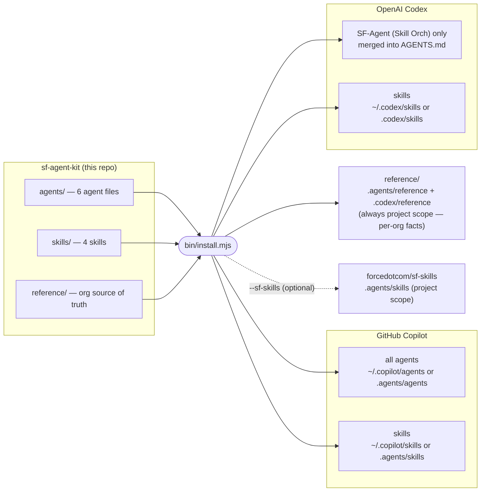
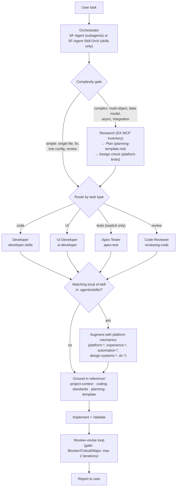

# sf-agent-kit

> Portable Salesforce development agents and skills for **GitHub Copilot** and **OpenAI Codex** — install once, use anywhere.

A single source of truth for your custom AI agents and skills. Author them once, then install them into any supported tool on any device with one command.

---

## Overview

`sf-agent-kit` packages a curated set of Salesforce-focused **agents** (orchestrators and specialists) and **skills** (reusable workflows) and installs them into each tool's expected location and format:

| Asset | GitHub Copilot | OpenAI Codex |
| --- | --- | --- |
| Skills (user) | `~/.copilot/skills` | `~/.codex/skills` |
| Skills (workspace) | `./.agents/skills` | `./.codex/skills` |
| Reference (project, always) | `./.agents/reference` | `./.codex/reference` |
| Agents (user) | all agents → `~/.copilot/agents` | SF-Agent (Skill Orch) → `~/.codex/AGENTS.md` |

Skills share the same `SKILL.md` format across both tools, so they are 100% portable. Agents differ per tool, so Copilot receives every agent while Codex receives the single orchestrator merged into its `AGENTS.md`.

**Reference** is a project-specific source of truth (org-specific coding standards, a planning template, and an org-context scaffold) that skills and agents read *before* planning or generating code, so output is consistent prompt-to-prompt. It deliberately carries only what the model can't reliably know (your org's facts and opinionated conventions), not generic Salesforce best practice. It **always installs at project scope** (into the current project, never your user profile) because `project-context.md` is per-org. Skills cite the reference rather than restating it — edit it in one place. Populate `reference/project-context.md` with your org's facts to get the biggest accuracy gain.

## Repository structure

```text
sf-agent-kit/
├── agents/            # *.agent.md files (Copilot subagents)
├── skills/            # skill folders, each with a SKILL.md
├── reference/         # project source of truth cited by skills + agents
├── bin/install.mjs    # cross-tool installer
└── package.json
```

## How it flows

### Install flow



### Runtime flow (how a task resolves)



### Conflict precedence (who wins when guidance disagrees)

1. **Kit skill + `reference/`** — your intent: workflow, conventions, naming, checklists, output format
2. **Local sf-skills** — platform mechanics only: current API/tool syntax, CLI commands, metadata formats (they track platform changes)
3. **Generic model knowledge** — fills remaining gaps

> sf-skills are renamed upstream often; skills match them by domain-first prefix (`platform-*`, `experience-*`, `automation-*`, `design-systems-*`, `dx-*`), never by hardcoded name.

## Quick start

Install everything to all supported tools (recommended):

```bash
npx github:Daryl-webdev/sf-agent-kit --all
```

## Usage

```bash
# Pick a specific tool
npx github:Daryl-webdev/sf-agent-kit --copilot
npx github:Daryl-webdev/sf-agent-kit --codex

# Scope to the current repository instead of the user profile
npx github:Daryl-webdev/sf-agent-kit --all --workspace

# Overwrite files that already exist
npx github:Daryl-webdev/sf-agent-kit --all --force
```

### Flags

| Flag | Description |
| --- | --- |
| `--all` | Install to Copilot and Codex (default when no tool flag is given) |
| `--copilot` | Install to GitHub Copilot only |
| `--codex` | Install to OpenAI Codex only |
| `--workspace` | Install into the current repo instead of the user home directory |
| `--force` | Overwrite existing files |
| `--sf-skills` | Also install Salesforce's official skills (`forcedotcom/sf-skills`). Bare flag opens the CLI's interactive picker; `--sf-skills=all` installs everything; `--sf-skills=a,b` installs specific skills |
| `--no-sf-skills` | Skip the sf-skills prompt entirely |

> sf-skills installs via `npx skills add forcedotcom/sf-skills`. The target agents (`github-copilot`/`codex`) are derived from your flags and sf-skills always install at project (local) scope — `.agents/skills` — never user-level. `--sf-skills=all` or `--sf-skills=a,b` add `-y` to skip all CLI prompts; the bare flag leaves selection interactive.

## Command reference

All flags combine freely. Base command: `npx github:Daryl-webdev/sf-agent-kit`.

**Tool selection**
```bash
npx github:Daryl-webdev/sf-agent-kit              # default: Copilot + Codex
npx github:Daryl-webdev/sf-agent-kit --all        # both (explicit)
npx github:Daryl-webdev/sf-agent-kit --copilot    # Copilot only
npx github:Daryl-webdev/sf-agent-kit --codex      # Codex only
```

**Scope**
```bash
npx github:Daryl-webdev/sf-agent-kit --all                # user (~/.copilot, ~/.codex)
npx github:Daryl-webdev/sf-agent-kit --all --workspace    # this repo (.agents, .codex)
```

**Force overwrite**
```bash
npx github:Daryl-webdev/sf-agent-kit --all --force
npx github:Daryl-webdev/sf-agent-kit --copilot --workspace --force
```

**sf-skills**
```bash
npx github:Daryl-webdev/sf-agent-kit --all                  # interactive y/N prompt (default no)
npx github:Daryl-webdev/sf-agent-kit --all --no-sf-skills   # skip prompt entirely
npx github:Daryl-webdev/sf-agent-kit --all --sf-skills      # CLI interactive picker
npx github:Daryl-webdev/sf-agent-kit --all --sf-skills=all  # all sf-skills, no prompts
npx github:Daryl-webdev/sf-agent-kit --all --sf-skills=platform-apex-generate,automation-flow-generate
```

**Common combinations**
```bash
npx github:Daryl-webdev/sf-agent-kit --all --force --sf-skills=all        # everything, both tools, user
npx github:Daryl-webdev/sf-agent-kit --copilot --sf-skills=all            # Copilot only + all sf-skills
npx github:Daryl-webdev/sf-agent-kit --codex --workspace --sf-skills=all  # Codex, this repo + all sf-skills
npx github:Daryl-webdev/sf-agent-kit --all --workspace --no-sf-skills     # both, repo-scoped, no sf-skills
```

**npm scripts (local clone)**
```bash
npm run install:all        # --all
npm run install:copilot    # --copilot
npm run install:codex      # --codex
npm run install:workspace  # --all --workspace
```

## Requirements

- Node.js >= 18

## Updating

Edit files in `agents/`, `skills/`, or `reference/`, commit and push, then re-run the installer with `--force`:

```bash
npx github:Daryl-webdev/sf-agent-kit --all --force
```

## License

MIT
